<h1 align="center">
  <picture>
    <source media="(max-width: 600px) and (prefers-color-scheme: light)" srcset=".github/assets/banner-phone-light.svg">
    <source media="(max-width: 600px)" srcset=".github/assets/banner-phone.svg">
    <source media="(prefers-color-scheme: light)" srcset=".github/assets/banner-light.svg">
    
  </picture>
</h1>

<div align="center">

[](https://github.com/yungSNAT/Puritanical/actions/workflows/test.yml) [](https://app.codecov.io/gh/yungSNAT/Puritanical/tree/main) [](https://github.com/yungSNAT/Puritanical/actions/workflows/codeql.yml) [](https://github.com/yungSNAT/Puritanical/actions/workflows/osv-scanner.yml) [](https://sonarcloud.io/dashboard?id=yungSNAT_Puritanical) [](https://app.codacy.com/gh/yungSNAT/Puritanical/dashboard)<br>
[](https://scorecard.dev/viewer/?uri=github.com/yungSNAT/Puritanical)<br>
[](LICENSE) [](https://github.com/yungSNAT/Puritanical/releases) [](https://github.com/JayPokale/Chisle)

[Install](#install) · [Use](#use) · [The rules](#the-rules) · [Development](#development) · [Credits](#credits) · [Licence](#licence)

</div>

Puritanical guides coding agents towards the smallest correct change. It asks the agent to read the code and its callers, check whether a reported bug still exists and preserve the behaviour callers rely on. The name comes from the Puritan practice of stripping away what scripture did not warrant.

## Install

For Codex, clone the fork and install its rules with Node.js 18 or later.

```powershell
git clone https://github.com/yungSNAT/Puritanical.git
Set-Location Puritanical
node bin/install.js --only codex
```

The installer adds a marked block to your personal `~/.codex/AGENTS.md`. If the block already exists, add `--force` to refresh it. Start a new chat to load the rules. To remove the block, run `node bin/install.js --uninstall --only codex`.

For one Claude Code session, run `claude --plugin-dir .` from the clone. For a project that reads `AGENTS.md`, you can also copy the [project rules](AGENTS.md) into its existing instructions.

## Use

Ask the agent to ‘fix pagination dropping the first item on page 2’. If the reported case and nearby page boundaries already work, it should explain what it checked and leave the files alone. If the bug persists, it should fix the calculation shared by the affected callers. Review the evidence and the diff.

Use `/puritanical off` to pause the Claude Code plugin and `/puritanical` to resume it. Its review skill looks for unnecessary code in a diff. [Commands and configuration](docs/usage.md#usage) · [Review skill](skills/puritanical-review/SKILL.md)

## The rules

1. Check the report against the current implementation and its callers.
2. Reuse existing code, the standard library, platform features or installed dependencies where they meet the request. Write new code when the simpler options fall short.
3. Follow the caller’s error policy. A best-effort CSV import can keep valid rows and report skips. An atomic inventory update must reject an invalid batch before changing any stock.
4. Keep input validation, security, accessibility and error handling that prevents data loss. Keep the explanation short enough to read and complete enough to act on.

[Full coding rules](skills/puritanical/SKILL.md)

## Development

Edit the [canonical skill](skills/puritanical/SKILL.md), then run `npm run build:rules` to regenerate its copies. Run the following checks from the clone.

```powershell
npm test
npm run check:rules
npm run check:chart
npm run check:readme-art
```

The generators and benchmark analysis are a Rust crate in [tools/](tools/); `cd tools && cargo test` runs its tests.

### Project checks

The test suite runs on Node.js 18, 20 and 22, and the [Rust workflow](.github/workflows/rust.yml) checks the tools crate on Linux and Windows. The [test workflow](.github/workflows/test.yml) holds the Node 22 run to 100% line coverage and sends its report to Codecov, beside the Rust crate's, and runs the quality grader's code answers inside its bubblewrap sandbox. CodeQL scans JavaScript, TypeScript, Python and GitHub Actions. OSV-Scanner checks dependency lockfiles for published advisories. The Codacy badge shows the hosted project grade. The [Codacy CLI workflow](https://github.com/yungSNAT/Puritanical/actions/workflows/codacy.yml) also publishes a downloadable report for each run. OpenSSF Scorecard assesses repository practices. The release badge reads the GitHub release feed.

## Credits

Ryan Duguid maintains Puritanical. Jay Pokale wrote the upstream plugin. The original Puritanical banner uses Cascadia Mono and Besley lettering. [Upstream and third-party credits](NOTICE)

## Licence

Ryan Duguid's code is under Apache-2.0; see [LICENSE](LICENSE). If you redistribute this work or build on it, keep the attribution in [NOTICE](NOTICE). Code from Chisle, which this repository forks, and the caveman and ponytail portions it carries remain under the MIT License; [NOTICE](NOTICE) holds their notices. Earlier commits keep the licence their LICENSE file named. The restored banner artwork is © 2026 Ryan Duguid and carries its original [Apache 2.0 licence](.github/assets/LICENSE-banner.txt). Its lettering uses glyphs distributed under SIL OFL 1.1.

Scripture quoted by permission. Quotations designated (NET) are from the NET Bible® copyright ©1996, 2019 by Biblical Studies Press, L.L.C. All rights reserved.

---

<p align="center"><sub><i>'Do not add a thing to what I command you nor subtract from it.'</i> Deuteronomy 4:2 (<a href="https://netbible.org/">NET</a>)<br>Maintained by <a href="https://github.com/yungSNAT">yungSNAT</a>. <i>Ad gloriam eius, non meam.</i></sub></p>
